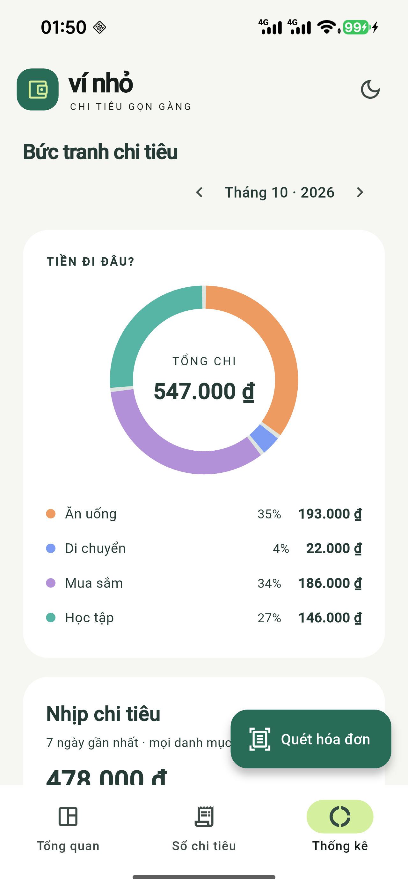
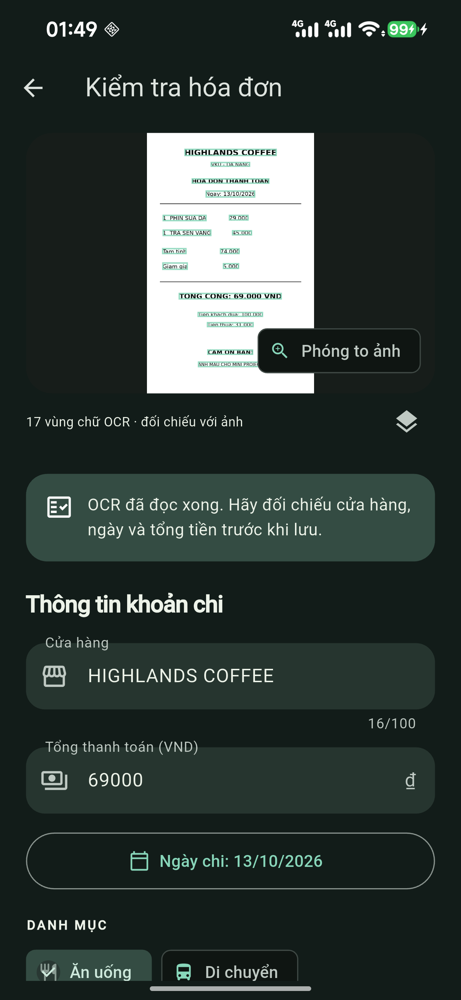
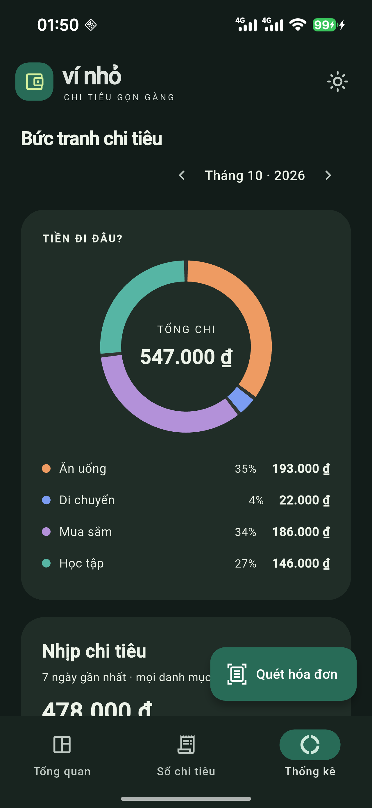

# Ví Nhỏ

Ứng dụng Flutter Android giúp quét hóa đơn và theo dõi chi tiêu cá nhân. Nhận diện chữ bằng ML Kit trên thiết bị, kiểm tra thông tin trước khi lưu, và quản lý dữ liệu bằng SQLite.

**[Tải APK v1.1.0](https://github.com/Kalte-Luft/vi-nho/releases/download/v1.1.0/app-release.apk)** · Android 7.0 trở lên.

## Tính năng

- Chụp hóa đơn hoặc chọn ảnh từ thư viện; trích xuất cửa hàng, ngày và tổng thanh toán.
- Đối chiếu các khung chữ OCR trên ảnh, phóng to, sửa dữ liệu và xác nhận trước khi lưu.
- Sau khi lưu, tự mở thống kê đúng tháng của hóa đơn và cập nhật biểu đồ.
- Thêm thủ công, sửa và xóa khoản chi; tìm kiếm không phân biệt dấu, lọc theo tháng và danh mục.
- Ngân sách tháng, số tiền còn lại và cảnh báo vượt ngân sách.
- Biểu đồ donut theo danh mục và biểu đồ cột 7 ngày gần nhất, tự vẽ bằng `CustomPainter` với animation.
- Material 3, giao diện tiếng Việt và chế độ sáng/tối.
- Lưu dữ liệu và bản sao ảnh trên thiết bị, không cần đăng nhập hay máy chủ.

## Ảnh chụp màn hình

Các ảnh dưới đây được chụp trên điện thoại Android 16, bản v1.1.0; biểu đồ gồm dữ liệu mẫu và hóa đơn mẫu dùng để kiểm tra OCR.

| Thống kê sáng | Kiểm tra hóa đơn | Thống kê tối |
|:---:|:---:|:---:|
|  |  |  |

## Cài đặt APK

1. Tải [app-release.apk](https://github.com/Kalte-Luft/vi-nho/releases/download/v1.1.0/app-release.apk) về điện thoại.
2. Mở file và cho phép cài ứng dụng từ nguồn này khi Android yêu cầu.
3. Mở **Ví Nhỏ**, chọn **Quét hóa đơn** và đối chiếu thông tin trước khi lưu.

Dữ liệu vẫn còn sau khi đóng/mở ứng dụng. Gỡ ứng dụng hoặc xóa dữ liệu trong Android Settings sẽ xóa sổ chi tiêu và ảnh đã lưu. Bản cập nhật cần dùng cùng khóa ký để giữ dữ liệu.

## Chạy từ mã nguồn

Cần Flutter stable với Dart 3.9+, Android SDK và JDK đầy đủ (khuyến nghị JDK 21). Gradle 8.14.3 không tương thích Java 25.

```bash
git clone https://github.com/Kalte-Luft/vi-nho.git
cd vi-nho
flutter pub get
flutter doctor -v
flutter devices
flutter run -d DEVICE_ID
```

Bật USB debugging trên điện thoại và chấp nhận kết nối từ máy tính. Thay `DEVICE_ID` bằng ID Android từ `flutter devices`. Dùng debug để hot reload; nếu đã cài APK release có chữ ký khác, cần lưu ý dữ liệu trước khi chuyển bản cài.

Trên Linux x64, có thể dùng JDK cục bộ:

```bash
python3 tool/setup_jdk21.py
bash tool/flutter_android.sh run -d DEVICE_ID
```

Script tải Eclipse Temurin JDK 21 và kiểm tra SHA-256, lưu trong `.tools/` được gitignore. Có thể đặt `VI_NHO_JAVA_HOME` để dùng JDK ở đường dẫn khác. OCR native yêu cầu Android; dự án không cấu hình web hoặc Linux desktop.

## Build release

```bash
bash tool/create_release_key.sh
bash tool/flutter_android.sh build apk --release
```

APK được tạo tại `build/app/outputs/flutter-apk/app-release.apk`. Trên Windows/macOS có JDK phù hợp, có thể dùng `flutter build apk --release` sau khi tạo cấu hình ký.

Khóa ký nằm ở `android/vi-nho-release.jks` và `android/key.properties`, được gitignore. Giữ bản sao riêng để ký các bản cập nhật; không đưa khóa hoặc mật khẩu lên repository.

## Công nghệ và cấu trúc

Flutter / Dart, `image_picker`, `google_mlkit_text_recognition`, Riverpod **2.6.1**, `sqflite`, `path_provider` và `intl`. Các phiên bản được khóa trong `pubspec.lock`.

```text
lib/
  main.dart     ProviderScope, locale và theme
  core/         Material 3 theme và màu sắc
  models/       Expense, ReceiptEvidence và tọa độ dòng OCR
  services/     Camera, ML Kit, Regex parser, SQLite CRUD và lưu ảnh
  state/        AppController (NotifierProvider) + immutable AppState
  widgets/      Biểu đồ CustomPainter, ảnh có khung OCR, expense card
  screens/      Tổng quan, lịch sử, review và thống kê
```

Parser ưu tiên dòng “Tổng cộng/Thanh toán/Grand total/Amount due”, bỏ qua tạm tính, tiền khách đưa và tiền thừa. Khi không đọc được một trường, ứng dụng yêu cầu người dùng kiểm tra và nhập lại. Hỗ trợ VND và ngày dạng `dd/MM/yyyy` hoặc `dd-MM-yy`; chưa hỗ trợ ngoại tệ hoặc chữ viết tay. Độ rõ của ảnh và bố cục hóa đơn ảnh hưởng kết quả OCR.

## Kiểm thử

```bash
flutter analyze
flutter test
```

Bộ kiểm thử bao phủ parser, SQLite CRUD/settings và migration v1 → v2, lưu ảnh, trạng thái bất biến, lỗi lưu dữ liệu, vòng đời notifier và xác nhận bản nháp OCR. Kết quả bản v1.1.0 và phạm vi kiểm tra trên điện thoại được ghi tại [WEEK8_VERIFICATION.md](docs/WEEK8_VERIFICATION.md).

## Luồng dữ liệu

Camera/thư viện → ML Kit → Regex → **Review & xác nhận** → SQLite → `NotifierProvider` → biểu đồ `CustomPainter`.

Bản nháp OCR chưa ghi vào database. Người dùng sửa cửa hàng, ngày, số tiền, danh mục và tích xác nhận sau khi đối chiếu ảnh. `AppController` chờ ghi SQLite hoàn tất rồi phát snapshot mới; màn hình thống kê cập nhật theo tháng khoản chi. Lỗi lưu giữ nguyên form để thử lại.

SQLite v2 bổ sung cột nullable `ocr_evidence` (JSON kích thước ảnh và khung từng dòng chữ). Migration giữ khoản chi, ảnh và settings từ v1; hóa đơn cũ vẫn mở được dù chưa có khung OCR. Ảnh gốc và văn bản OCR được giữ để đối chiếu sau này.

## Tài liệu

- [Báo cáo kỹ thuật Week 8 (PDF)](docs/vi-nho-week8-report.pdf): kiến trúc, bảng Regex, ảnh sáng/tối và giới hạn.
- [Kết quả xác minh bản v1.1.0](docs/WEEK8_VERIFICATION.md).
- [Báo cáo Week 7](vi-nho-w7-report.md) là tài liệu của bản v1.0.0.

Video demo camera hóa đơn thật sẽ được tác giả quay và bổ sung riêng.
